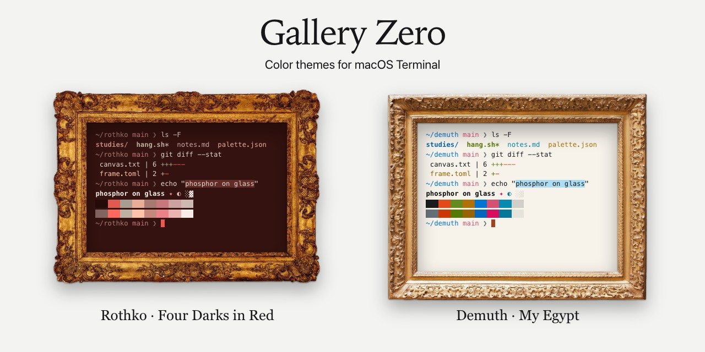
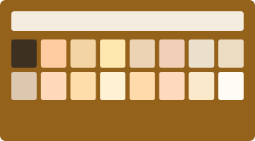
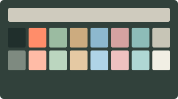
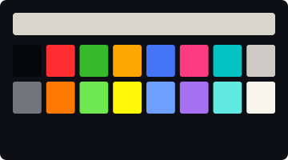
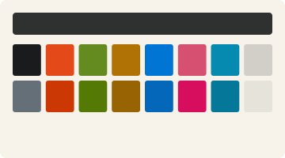

# Gallery Zero

56 free color themes for macOS Terminal, Ghostty, iTerm2, kitty, WezTerm, Alacritty and Warp, drawn from the work of eight artists. Install all 56 from the command line, or download them one at a time from the gallery.

[](https://bigcactuslabs.github.io/gallery-zero/)

**[Visit the gallery →](https://bigcactuslabs.github.io/gallery-zero/)** Try a dark palette in [Rothko’s *Four Darks in Red*](https://bigcactuslabs.github.io/gallery-zero/#rothko-four-darks-in-red) or a light one in [Demuth’s *My Egypt*](https://bigcactuslabs.github.io/gallery-zero/#demuth-my-egypt).

Each work translates a painter's color relationships into the sixteen ANSI values that define a terminal session. The background becomes the canvas. The text becomes the light.

## Quick install

```sh
# Install all 56 themes into macOS Terminal (no Gatekeeper prompt):
curl -fsSL https://raw.githubusercontent.com/BigCactusLabs/gallery-zero/main/install.sh | sh

# Or install only specific packs (condo, de-amaral, demuth, monet, pelton, riley, rothko, tanaka):
curl -fsSL https://raw.githubusercontent.com/BigCactusLabs/gallery-zero/main/install.sh | sh -s -- rothko demuth

# Or install into another terminal (ghostty, iterm2, kitty, wezterm, alacritty, warp):
curl -fsSL https://raw.githubusercontent.com/BigCactusLabs/gallery-zero/main/install.sh | sh -s -- --terminal ghostty
```

In Terminal.app it keeps your current font, default, and startup profile. Elsewhere it copies the themes into the terminal's theme folder (see [Other terminals](#other-terminals)). Either way it cleans up after itself. Inspect [`install.sh`](install.sh) first, or see [Acquisitions](#acquisitions) for manual import via **Terminal → Settings → Profiles**.

---

## The Rothko Collection

Seven profiles after Mark Rothko (1903–1970). Oil on canvas, reconsidered as phosphor on glass.

### Four Darks in Red


Four dark bands on a red field. Every colour in the palette is a step between the painting's red-brown and the bright red of its border. After *Four Darks in Red*, 1958.

[Enter the Rothko gallery.](rothko/)

---

## The De Amaral Collection

Seven profiles after Olga de Amaral (b. 1932). Gold leaf and horsehair, reconsidered as phosphor on glass.

### Pirámide D



Gold leaf, edge to edge. The gold is the ground, and every colour in the palette is a step of it from amber to cream. After *Pirámide D*, 2004.

[Enter the De Amaral gallery.](de-amaral/)

---

## The Condo Collection

Seven profiles after George Condo (b. 1957). Psychological Cubism, reconsidered as phosphor on glass.

### The Fallen Butler


A butler collapsing at a crowded table: plum floor, scraped-white text, salmon flesh and a green bottle. After *The Fallen Butler*, 2009, at MoMA.

[Enter the Condo gallery.](condo/)

---

## The Monet Collection

Seven profiles after Claude Monet (1840–1926). Plein air and lily ponds, reconsidered as phosphor on glass.

### Brume



The painting that named a movement, before the sun burned through. After *Impression, Sunrise*, 1872.

[Enter the Monet gallery.](monet/)

---

## The Tanaka Collection

Seven profiles after Atsuko Tanaka (1932–2005). Neon circuits and painted light, rewired as phosphor on glass.

### Electric Dress



Two hundred bulbs in nine colors, worn like a second skin. The circuit that started everything. After *Electric Dress (Denkifuku)*, 1956.

[Enter the Tanaka gallery.](tanaka/)

---

## The Riley Collection

Seven profiles after Bridget Riley (b. 1931). Perceptual geometry, reconsidered as phosphor on glass.

### Red with Red 1


Two reds of equal lightness flicker against each other, cut by navy curves. The pink is the ground; the navy writes on it. After *Red with Red 1*, 2007.

[Enter the Riley gallery.](riley/)

---

## The Pelton Collection

Seven profiles after Agnes Pelton (1881–1961). Transcendental light, reconsidered as phosphor on glass.

### Ahmi in Egypt


A red path snakes up from the lower darkness toward a golden lotus. Indigo night, lit from within, hung behind a veil. After *Ahmi in Egypt*, 1931.

[Enter the Pelton gallery.](pelton/)

---

## The Demuth Collection

Seven profiles after Charles Demuth (1883–1935). Precisionist daylight, reconsidered as phosphor on glass — six light grounds for working by day, and one night piece.

### My Egypt



A grain elevator raised to the scale of a pyramid, crossed by rays of light. The white of the silos is the ground, and brick orange, amber and two sky blues are set on it at full strength. After *My Egypt*, 1927, at the Whitney.

[Enter the Demuth gallery.](demuth/)

---

## Acquisitions

Download one from [the gallery site](https://bigcactuslabs.github.io/gallery-zero/), or all 56 as [one zip](https://bigcactuslabs.github.io/gallery-zero/gallery-zero.zip). Pick your terminal at the top of the site and every download follows it.

**In Terminal Settings (recommended for browser downloads):** Open **Terminal → Settings** (`⌘,`) **→ Profiles**, then drag any `.terminal` file into the profiles list — or click the **⋯** button at the bottom of the list and choose **Import…**. Select it and click **Default** if you like.

*(macOS Gatekeeper blocks double-clicking `.terminal` files downloaded through a browser, because the format can carry startup commands. Gallery Zero profiles contain only colors and window settings — no commands. Importing through Settings reads the file directly without triggering Gatekeeper, or you can clear the quarantine flag with `xattr -dr com.apple.quarantine <file-or-folder>`.)*

**From the command line (no quarantine, no repo left behind):**

```sh
# All 56 themes:
curl -fsSL https://raw.githubusercontent.com/BigCactusLabs/gallery-zero/main/install.sh | sh

# Just specific packs:
curl -fsSL https://raw.githubusercontent.com/BigCactusLabs/gallery-zero/main/install.sh | sh -s -- rothko demuth

# List available packs or preview without installing:
curl -fsSL https://raw.githubusercontent.com/BigCactusLabs/gallery-zero/main/install.sh | sh -s -- --list
curl -fsSL https://raw.githubusercontent.com/BigCactusLabs/gallery-zero/main/install.sh | sh -s -- --dry-run rothko
```

[`install.sh`](install.sh) fetches a fresh archive into a temporary directory, runs `tools/profiles.py install-terminal` (keeping your font, default, and startup profile), and removes the temporary directory on exit.

Or, from a cloned repository (`git clone` doesn't add a quarantine flag):

```sh
./install.sh rothko demuth
# or open individual profiles directly:
open "rothko/Rothko — Four Darks in Red.terminal"
open "de-amaral/De Amaral — Pirámide D.terminal"
open "condo/Condo — The Fallen Butler.terminal"
open "monet/Monet — Brume.terminal"
open "tanaka/Tanaka — Electric Dress.terminal"
open "riley/Riley — Red with Red 1.terminal"
open "pelton/Pelton — Ahmi in Egypt.terminal"
open "demuth/Demuth — My Egypt.terminal"
```

## Other terminals

The same 56 palettes hang in six more terminals. Add `--terminal` to the installer, or download the files from the gallery site or [`terminals/`](terminals/):

| Terminal | `--terminal` | Installs to | Then |
| --- | --- | --- | --- |
| [Ghostty](https://ghostty.org) | `ghostty` | `~/.config/ghostty/themes` | Set `theme = Rothko — Four Darks in Red` in your config. |
| [iTerm2](https://iterm2.com) | `iterm2` | One [Dynamic Profiles](https://iterm2.com/documentation-dynamic-profiles.html) file per collection | Pick a profile tagged *Gallery Zero* in **Settings → Profiles**. |
| [kitty](https://sw.kovidgoyal.net/kitty/) | `kitty` | `~/.config/kitty/themes` | Run `kitten themes`. They are listed under *User*. |
| [WezTerm](https://wezterm.org) | `wezterm` | `~/.config/wezterm/colors` | Set `config.color_scheme = "Rothko — Four Darks in Red"`. |
| [Alacritty](https://alacritty.org) | `alacritty` | `~/.config/alacritty/themes` | Add the file's path to `import` under `[general]` in `alacritty.toml`. |
| [Warp](https://www.warp.dev) | `warp` | `~/.warp/themes` (Linux: `~/.local/share/warp-terminal/themes`) | Choose it in **Settings → Appearance → Themes**. |

```sh
# Just the Rothko and Demuth rooms, into kitty:
curl -fsSL https://raw.githubusercontent.com/BigCactusLabs/gallery-zero/main/install.sh | sh -s -- --terminal kitty rothko demuth
```

The installer honours `XDG_CONFIG_HOME` and `KITTY_CONFIG_DIRECTORY`, and runs on Linux for every terminal except Terminal.app and iTerm2. Running it again updates only the themes that changed. `--prune` removes Gallery Zero themes that have left the gallery. It deletes only files that carry the gallery's header, so a theme of your own stays even when it shares an artist's name.

The ports carry the palette: the sixteen ANSI colors, background, foreground, cursor and, except in Warp, whose themes have no such key, selection. Terminal.app's glass, window size and title stay in the `.terminal` profiles. Terminal.app leaves selected text in its own color, and so do Ghostty, kitty, WezTerm, Alacritty and the installed iTerm2 profiles. Those profiles also switch off iTerm2's separate light and dark colors, which iTerm2 turns on by default and which would hide the palette. Ghostty reads a comma in a theme name as a light/dark pair, so two works drop theirs there: *Tanaka — Thanks Sam* and *Demuth — Buildings Lancaster*. For iTerm2's own import, [`terminals/iterm2/`](terminals/iterm2/) holds `.itermcolors` presets for **Settings → Profiles → Colors → Color Presets… → Import…**.

## Conservation Notes

How the gallery is built — plist archaeology, archived color blobs, glass, escape codes. See [TECHNIQUES.md](TECHNIQUES.md).

## License

The themes, swatches and wall text are licensed under [CC BY 4.0](LICENSE). Share and adapt them freely with credit to Gallery Zero. The paintings themselves belong to their artists and estates; only the sampled palettes are offered here.

## Forthcoming Exhibitions

New artist series are underway. The gallery accepts loans.
