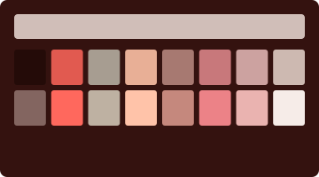
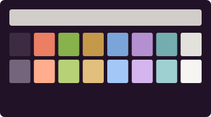
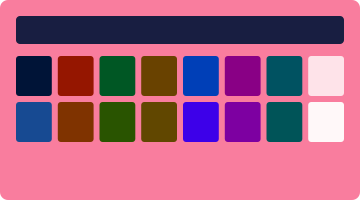

# Gallery Zero

Color themes for macOS Terminal, curated from the permanent collection.

Each work translates a painter's color relationships into the sixteen ANSI values that define a terminal session. The background becomes the canvas. The text becomes the light.

---

## The Rothko Collection

Seven profiles after Mark Rothko (1903–1970). Oil on canvas, reconsidered as phosphor on glass.

### Four Darks in Red



Four dark bands on a red field. Every colour in the palette is a step between the painting's red-brown and the bright red of its border. After *Four Darks in Red*, 1958.

[Enter the Rothko gallery.](rothko/)

---

## The De Amaral Collection

Seven profiles after Olga de Amaral (b. 1932). Gold leaf and horsehair, reconsidered as phosphor on glass.

### Pirámide D


Gold leaf, edge to edge. The gold is the ground, and every colour in the palette is a step of it from amber to cream. After *Pirámide D*, 2004.

[Enter the De Amaral gallery.](de-amaral/)

---

## The Condo Collection

Seven profiles after George Condo (b. 1957). Psychological Cubism, reconsidered as phosphor on glass.

### The Fallen Butler



A butler collapsing at a crowded table: plum floor, scraped-white text, salmon flesh and a green bottle. After *The Fallen Butler*, 2009, at MoMA.

[Enter the Condo gallery.](condo/)

---

## The Monet Collection

Seven profiles after Claude Monet (1840–1926). Plein air and lily ponds, reconsidered as phosphor on glass.

### Brume


The painting that named a movement, before the sun burned through. After *Impression, Sunrise*, 1872.

[Enter the Monet gallery.](monet/)

---

## The Tanaka Collection

Seven profiles after Atsuko Tanaka (1932–2005). Neon circuits and painted light, rewired as phosphor on glass.

### Electric Dress


Two hundred bulbs in nine colors, worn like a second skin. The circuit that started everything. After *Electric Dress (Denkifuku)*, 1956.

[Enter the Tanaka gallery.](tanaka/)

---

## The Riley Collection

Seven profiles after Bridget Riley (b. 1931). Perceptual geometry, reconsidered as phosphor on glass.

### Red with Red 1



Two reds of equal lightness flicker against each other, cut by navy curves. The pink is the ground; the navy writes on it. After *Red with Red 1*, 2007.

[Enter the Riley gallery.](riley/)

---

## The Pelton Collection

Seven profiles after Agnes Pelton (1881–1961). Transcendental light, reconsidered as phosphor on glass — four of them, for the first time, translucent.

### Ahmi in Egypt


A red path snakes up from the lower darkness toward a golden lotus. Indigo night, lit from within, hung behind a veil. After *Ahmi in Egypt*, 1931.

[Enter the Pelton gallery.](pelton/)

---

## Acquisitions

Double-click any `.terminal` file. It will appear in **Terminal → Preferences → Profiles**. Select it. Set it as default if you like.

Or, from the command line:

```sh
open "rothko/Rothko — Four Darks in Red.terminal"
open "de-amaral/De Amaral — Pirámide D.terminal"
open "condo/Condo — The Fallen Butler.terminal"
open "monet/Monet — Brume.terminal"
open "tanaka/Tanaka — Electric Dress.terminal"
open "riley/Riley — Red with Red 1.terminal"
open "pelton/Pelton — Ahmi in Egypt.terminal"
```

## Conservation Notes

How the gallery is built — plist archaeology, archived color blobs, glass, escape codes. See [TECHNIQUES.md](TECHNIQUES.md).

## Forthcoming Exhibitions

New artist series are underway. The gallery accepts loans.
