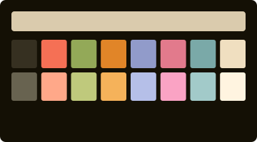
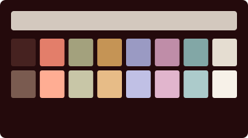
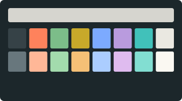

# The Condo Collection

Seven profiles after George Condo (b. 1957). Psychological Cubism, reconsidered as phosphor on glass.

Seven paintings from four decades, from an early abstraction of 1983 to the head compositions of 2018. Condo calls his approach Artificial Realism: the realistic representation of that which is artificial. Six of the rooms are dark, each on a different near-black taken from its canvas (olive, oxblood, navy, plum, slate, violet), and one is light. Every palette is sampled from an image of its painting.

---

### Untitled 1983



A black field with a burst of vermilion, orange and crimson, and olive moss at the edges. Vermilion and moss green run at full strength on the canvas black; blue and cyan stay quiet because the painting barely has them. After *Untitled*, 1983.

### Dancing to Miles



A wall of drawn faces in sepia, painted in Keith Haring's studio. Oxblood black with sand-coloured text, every colour kept inside the painting's sepia range, and only rust at full strength. After *Dancing to Miles*, 1985–86.

### Couple on Blue Striped Chair


The light room. A pale wash of the painting's leaf-green field, teal-black text from the stockings, and inks from the chair's cobalt, the red-orange, rose and flesh. After *Couple on Blue Striped Chair*, 2005.

### Nude 33


A nude against navy quatrefoil wallpaper. The wall is the ground and its pale blue tracery is the text; flesh coral and tracery blue run at full strength, and white takes the lilac of the fur. After *Untitled (Nude 33)*, 2008.

### The Fallen Butler


A butler collapsing at a crowded table. The black floor with its lilac scumble becomes a plum ground, the pale scraped wall becomes the text, and salmon flesh and the green bottle run at full strength. After *The Fallen Butler*, 2009, at MoMA.

### Lost at Sea



A cubist head over a grey sea. Storm slate with chalk-white text; cobalt and orange-red run at full strength, with tan, teal, lemon and lavender from the head. After *Lost at Sea*, 2014.

### Green and Purple Head


The most saturated ground in the collection: the painting's violet field, deepened, with bone text. Leaf and emerald greens run at full strength against it, with orange-red from the line work. After *Green and Purple Head Composition*, 2018.

---

## Framing

Every frame is a uniform 110×30. The glass is thinnest, with the most blur, on the two rooms that are mostly atmosphere: *Lost at Sea* and the smoky *Dancing to Miles*. *Green and Purple Head* and *Untitled 1983* sit behind the densest panes, and their line spacing is the tightest in the set. *Nude 33* and *Lost at Sea* get the most room between lines. The cursor blinks in the four paintings with the most movement: *Untitled 1983*, *Dancing to Miles*, *Couple on Blue Striped Chair* and *Green and Purple Head*.

Each title bar carries a museum placard, such as *The Fallen Butler — Condo, 2009*, alongside the working directory. The full recipe per theme lives in [`themes/condo.json`](../themes/condo.json), and the techniques are documented in [TECHNIQUES.md](../TECHNIQUES.md).

---

## Acquisition

Double-click any `.terminal` file in this directory. It will appear in **Terminal → Preferences → Profiles**. Select it. Set it as default if you like.

Or, from the command line:

```sh
open "Condo — The Fallen Butler.terminal"
open "Condo — Dancing to Miles.terminal"
```

---

[Return to the main gallery.](../README.md)
