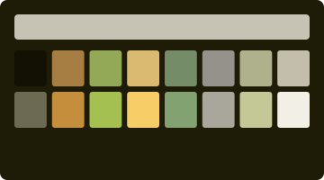
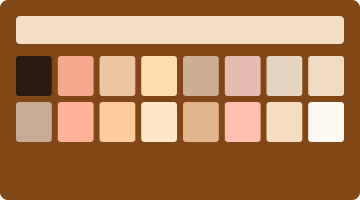
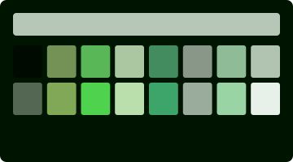
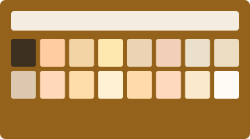
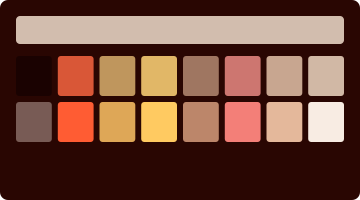
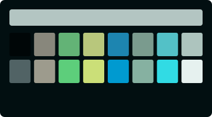

# The De Amaral Collection

Seven profiles after Olga de Amaral (b. 1932). Gold leaf and horsehair, reconsidered as phosphor on glass.

Seven works from 1995 to 2019, each sampled from an image of the piece on the artist's studio site. Most of her works are one or two materials, so six of these palettes are scales of the work's own colours, with slots told apart by lightness and strength; *Nébula 8* has enough colours to fill the standard slots. Four rooms are dark (olive, green-black, oxblood, teal-black) and three take a colour of the work as the ground: copper, gold and turquoise.

---

### Alquimia Plata



Moss green, gold leaf and silver leaf on linen. A dark olive ground with two steps of the moss, two of the gold, one dull olive and one silver grey. After *Alquimia plata 6 (B)*, 1995.

### Lienzo B



A black centre inside a copper border. The copper is the ground, and every slot is a step from that copper up to the pale linen at the fringe. Its colours render unadjusted at 3.5:1 or better. After *Lienzo B*, 2014.

### Bruma D1


A turquoise block painted across indigo threads. The light room: the turquoise is the ground and the indigo is the text, with every slot a step of that indigo from violet to deep teal. Its colours render unadjusted at 3.5:1 or better. After *Bruma D1*, 2018.

### Moya F



One green throughout. A green-black ground, with slots that are strong, weak, slightly yellower and slightly bluer steps of the same green. After *Moya F*, 2013.

### Pirámide D



Gold leaf, edge to edge. The gold is the ground, darkened a little so pale gold can be read as text, and every slot is a step from amber to cream. Its colours render unadjusted at 3.5:1 or better. After *Pirámide D*, 2004.

### Cenit 2



A red field crossed by gold stitching. An oxblood ground with three steps of the red and three of the gold. After *Cenit 2*, 2019.

### Nébula 8



Teal, blue, green and lime under a grid of silver leaf. The one room on standard slots: the work's teal is cyan, its blue is blue, its green is green and its lime is yellow. It has no red or magenta, so those slots take the silver and a pale celadon. After *Nébula 8*, 2015.

---

## Framing

Every frame is a uniform 110×30. *Cenit 2* sits behind the densest, least blurred pane and has the tightest lines. *Bruma D1*, threads hanging in air, gets the most blur and the most room between lines, and *Pirámide D* gets the thinnest pane. The cursor blinks in *Moya F*, *Pirámide D* and *Cenit 2*.

Each title bar carries a museum placard, such as *Pirámide D — de Amaral, 2004*, alongside the working directory. Four profiles let Terminal adjust ANSI colours for contrast; *Lienzo B*, *Bruma D1* and *Pirámide D* set `"raw_ansi": true` so their colours render exactly as mixed. The full recipe per theme lives in [`themes/de-amaral.json`](../themes/de-amaral.json), and the techniques are documented in [TECHNIQUES.md](../TECHNIQUES.md).

---

## Acquisition

Install the full De Amaral collection from Terminal (skips Gatekeeper, keeps your font and default profile):

```sh
curl -fsSL https://raw.githubusercontent.com/BigCactusLabs/gallery-zero/main/install.sh | sh -s -- de-amaral
```

Or install manually: open **Terminal → Settings** (`⌘,`) **→ Profiles** and drag any `.terminal` file from this directory into the profiles list (or click **⋯ → Import…**). *(macOS Gatekeeper blocks double-clicking browser-downloaded `.terminal` files; importing through Settings skips it.)*

Or, from a cloned repository:

```sh
open "De Amaral — Pirámide D.terminal"
open "De Amaral — Bruma D1.terminal"
```

---

[Return to the main gallery.](../README.md)
