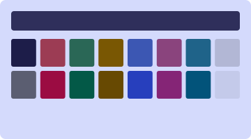
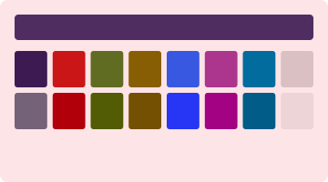

# The Demuth Collection

Seven profiles after Charles Demuth (1883–1935). Precisionist daylight, reconsidered as phosphor on glass.

Seven studies in daylight. Demuth painted the factories, steeples and grain elevators of Lancaster, Pennsylvania, in flat planes cut by rays of light, and before that he let watercolor run across wet paper on the Provincetown dunes. This is the gallery's first room hung entirely on light grounds, made for working by day: dark ink on pale sky, smoke, stone and one yellow sign.

---

### Sail in Two Movements



Sails folded into planes of indigo and violet, with pale yellow canvas between the masts. The periwinkle of the water is the ground and the indigo of the spars writes on it. After *Sail: In Two Movements*, 1919.

### End of the Parade


Three black stacks against white smoke in a steel town. Smoke-white ground, soot text, and quiet accents of brick, straw and slate sky. After *End of the Parade, Coatesville, Pa.*, 1920.

### Provincetown Dunes



Watercolor let loose on wet paper: scarlet, magenta, ultramarine and gold running down the dunes. The pink wash is the ground and the violet of the far ridge is the text. The loudest palette in the room. After *Provincetown Dunes*, 1914.

### Welcome to Our City


The Lancaster courthouse dome in ochre above brick-red roofs. Pale stone ground, dark umber text, and the reds and golds of the town. After *Welcome to Our City*, 1921.

### My Egypt


A grain elevator raised to the scale of a pyramid, crossed by rays of light. The sky is the ground; soot, brick, tan and two blues do the writing. After *My Egypt*, 1927, at the Whitney.

### Buildings, Lancaster


A feed-mill sign in yellow and ultramarine under a cloudless sky. The yellow of the sign is the ground and its blue lettering is the text, as painted. After *Buildings, Lancaster*, 1930, at the Whitney.

### After All


His last factory picture: carmine walls, a teal signal, and two tall chimneys in pale yellow-green. The chimney colour is the ground. After *After All*, 1933.

---

## Framing

Every frame is a uniform 110×30 behind the same pane of glass: 96% opacity, lightly frosted, the same when the window is inactive. The cursor is still and the line spacing is 1.08 throughout. All seven let Terminal adjust ANSI colors for contrast, so the sixteen colors stay readable on every ground.

Each title bar carries a museum placard — *My Egypt — Demuth, 1927* — alongside the working directory. The full recipe per theme lives in [`themes/demuth.json`](../themes/demuth.json), and the techniques are documented in [TECHNIQUES.md](../TECHNIQUES.md).

---

## Acquisition

Double-click any `.terminal` file in this directory. It will appear in **Terminal → Preferences → Profiles**. Select it. Set it as default if you like.

Or, from the command line:

```sh
open "Demuth — Sail in Two Movements.terminal"
open "Demuth — End of the Parade.terminal"
open "Demuth — Provincetown Dunes.terminal"
open "Demuth — Welcome to Our City.terminal"
open "Demuth — My Egypt.terminal"
open "Demuth — Buildings, Lancaster.terminal"
open "Demuth — After All.terminal"
```

---

[Return to the main gallery.](../README.md)
