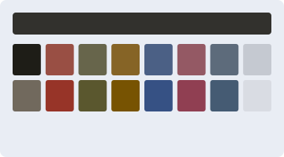
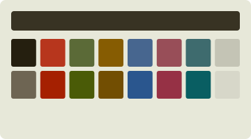

# The Demuth Collection

Seven profiles after Charles Demuth (1883–1935). Precisionist daylight, reconsidered as phosphor on glass.

Seven studies in daylight. Demuth painted the factories, steeples and grain elevators of Lancaster, Pennsylvania, in flat planes cut by rays of light. Before that he let watercolor run across wet paper on the Provincetown dunes, and between the factories he painted flowers. This is the gallery's first room made for working by day: six light grounds of sky, smoke, ochre and blush, with dark ink on each, and one navy night piece for the evening.

---

### Sail in Two Movements


Sails folded into planes of indigo and violet, with pale yellow canvas between the masts. The periwinkle of the water is the ground, the indigo of the spars writes on it, and every colour is a step between blue and violet. After *Sail: In Two Movements*, 1919.

### End of the Parade



Three black stacks against white smoke in a steel town. Smoke-white ground, soot text, and only the colours the picture has: brick, pink, straw, olive grey and slate sky. After *End of the Parade, Coatesville, Pa.*, 1920.

### Provincetown Dunes


Watercolor let loose on wet paper: scarlet, magenta, violet, ultramarine and gold running down the dunes. The pink wash is the ground and the plum of the far ridge is the text. After *Provincetown Dunes*, 1914.

### Welcome to Our City



The Lancaster courthouse dome in ochre above brick-red roofs. The ochre of the dome is the ground, and every colour is a step from brick red through rust to umber. After *Welcome to Our City*, 1921.

### My Egypt


A grain elevator raised to the scale of a pyramid, crossed by rays of light. The white of the silos is the ground, and brick orange, amber and two sky blues are set on it at full strength. After *My Egypt*, 1927, at the Whitney.

### Buildings, Lancaster


A feed-mill sign in yellow and ultramarine under a cloudless sky. The sky is the ground, the ultramarine of the lettering is the text, and the yellow of the sign marks the selection. After *Buildings, Lancaster*, 1930, at the Whitney.

### Calla Lilies


Two white lilies rising from a shell against deep navy, painted in memory of the performer Bert Savoy. The navy is the ground and the white of the lilies is the text, with leaf green, spadix gold and shell tan for colour. The one night piece in the room. After *Calla Lilies (Bert Savoy)*, 1927.

---

## Framing

Every frame is a uniform 110×30 behind the same pane of glass: 96% opacity, lightly frosted, the same when the window is inactive. The cursor is still and the line spacing is 1.08 throughout. Six let Terminal adjust ANSI colors for contrast, *Calla Lilies* among them. *My Egypt* shows its palette raw, so its colors keep their full strength on the white.

Each title bar carries a museum placard — *My Egypt — Demuth, 1927* — alongside the working directory. The full recipe per theme lives in [`themes/demuth.json`](../themes/demuth.json), and the techniques are documented in [TECHNIQUES.md](../TECHNIQUES.md).

---

## Acquisition

Install the full Demuth collection from Terminal (skips Gatekeeper, keeps your font and default profile):

```sh
curl -fsSL https://raw.githubusercontent.com/BigCactusLabs/gallery-zero/main/install.sh | sh -s -- demuth
```

Or install manually: open **Terminal → Settings** (`⌘,`) **→ Profiles** and drag any `.terminal` file from this directory into the profiles list (or click **⋯ → Import…**). *(macOS Gatekeeper blocks double-clicking browser-downloaded `.terminal` files; importing through Settings skips it.)*

Or, from a cloned repository:

```sh
open "Demuth — Sail in Two Movements.terminal"
open "Demuth — End of the Parade.terminal"
open "Demuth — Provincetown Dunes.terminal"
open "Demuth — Welcome to Our City.terminal"
open "Demuth — My Egypt.terminal"
open "Demuth — Buildings, Lancaster.terminal"
open "Demuth — Calla Lilies.terminal"
```

---

[Return to the main gallery.](../README.md)
