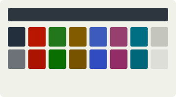
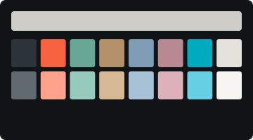
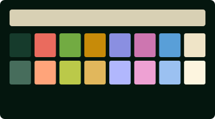
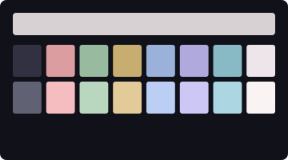
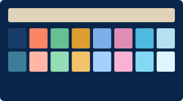
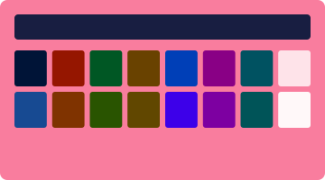
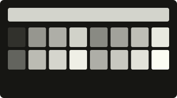

# The Riley Collection

Seven profiles after Bridget Riley (b. 1931). Perceptual geometry, reconsidered as phosphor on glass.

Seven studies in colour as a system. Riley built paintings like precise machines for the eye — stripes, curves, and lozenges deployed in strict repeating sequences until the surface begins to move. Five themes trace her colour years, from the morning she first let red, blue, and green into the work to the fixed "Egyptian palette" she carried home from the Nile. *Fall* returns to the black-and-white op art that started it all, and *Red with Red 1* jumps forward to the late curves. Every palette is sampled from an image of its painting.

---

### Late Morning



Red, blue, and green stood in rows until the eye mixed a green no one painted. The morning she let colour in, hung on the painting's own pale field, with red and green at full strength. After *Late Morning*, 1967–68.

### Cataract



Grey curves warm, stripe by stripe, into vermilion and turquoise. Only those two run at full strength; every other colour is held back toward grey, as the painting holds its edges. After *Cataract 3*, 1967.

### Nataraja



Lozenges of orange, violet, and green stacked into rhythm and counter-rhythm. Named for the dancer who keeps the universe in motion. After *Nataraja*, 1993.

### To a Summer's Day



Pale waves of blue, violet, pink, and ochre, twisting like light on moving water. After *To a Summer's Day 2*, 1980.

### Ka



The Egyptian palette — brick red, ochre, cornflower, turquoise — carried home from the Nile and fixed into law. Colour only: the ground is the cornflower field deepened, the text is pale ochre, and there is no black or white anywhere. After the *Ka* series, 1980.

### Red with Red 1



A pink-red and a vermilion at the same lightness, flickering against each other, cut by navy curves. The pink is the ground and the navy is the text. After *Red with Red 1*, 2007.

### Fall



A single curve, repeated until the surface vibrates at the edge of stillness. Grayscale only: every colour is a step between the canvas's olive charcoal and its warm ivory, told apart by lightness alone. After *Fall*, 1963.

---

## Framing

Every frame is a uniform 110×30, and the glass is cut to the surface — which, in Riley's case, is razor-flat and opaque almost everywhere. *Fall* and *Red with Red 1* hang behind the densest panes in the gallery; only *To a Summer's Day*, light on moving water, thins toward atmosphere. Line spacing stays tight where the pattern squeezes and relaxes where the stripes are codified into law. The cursor blinks with the optical churn — five of seven flicker — and holds still only in the Egyptian calm of *Ka* and the summer drift.

*Red with Red 1* is the second profile in the gallery, after Tanaka's *Neon District*, with Terminal's dynamic ANSI foregrounds switched off. A mid-light pink leaves no room for colourful text at 4.5:1, so its ANSI inks are held at 3.5:1 and shown as painted rather than pulled back toward navy. Text and bold stay above 7:1.

Each title bar carries a museum placard — *Fall — Riley, 1963* — alongside the working directory. The full recipe per theme lives in [`themes/riley.json`](../themes/riley.json), and the techniques are documented in [TECHNIQUES.md](../TECHNIQUES.md).

---

## Acquisition

Double-click any `.terminal` file in this directory. It will appear in **Terminal → Preferences → Profiles**. Select it. Set it as default if you like.

Or, from the command line:

```sh
open "Riley — Red with Red 1.terminal"
open "Riley — Ka.terminal"
```

---

[Return to the main gallery.](../README.md)
