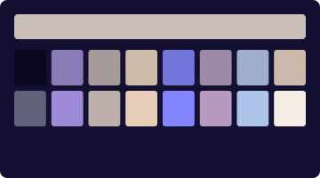
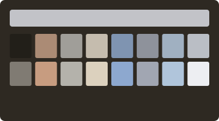
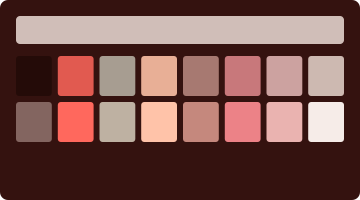
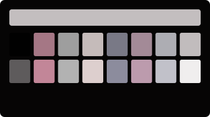
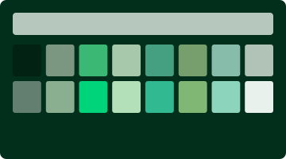
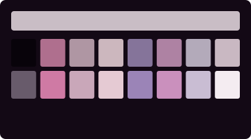

# The Rothko Collection

Seven profiles after Mark Rothko (1903–1970). Oil on canvas, reconsidered as phosphor on glass.

Seven paintings from 1957 to 1969, most of them from the dark late work. A Rothko has two or three colours, so these palettes do not bend the standard red, green, yellow and blue toward the painting. Every ANSI slot is a step on a scale of the painting's own hues, and the slots are told apart by lightness and strength. Six of the rooms are dark, each on a different ground taken from its canvas (navy, brown-black, red-brown, black, green, violet-black), and one is a teal field. Every palette is sampled from an image of its painting.

---

### Blue and Gray



A navy block and a warm grey block on a mauve surround. The ground is the navy, darkened; three slots step through that blue, one takes the mauve, and two take the warm grey. After *Blue and Gray*, 1962, at the Fondation Beyeler.

### Blue Divided by Blue


The one colour field in the set. The ground is the painting's deep teal, and every slot is a step from the pale band's sky blue up to white. Its colours render unadjusted at 3.5:1 or better. After *Untitled (Blue Divided by Blue)*, 1966.

### Black and Gray



A brown-black field over a cool grey one. Three slots are steps of the cool grey and three are steps of the warm brown that sits in the black. After *Untitled*, 1969, from the Black on Gray series, at the National Gallery of Art.

### Four Darks in Red



Four dark bands on a red field. The ground is the wide red-brown band; the slots step from that brown up to the bright red of the border, with one warm grey from the black band. After *Four Darks in Red*, 1958, at the Whitney Museum.

### Untitled 1969



Black on black. A grey scale on a near-black ground, with the faint plum of the border in the red and magenta slots only. After *Untitled*, 1969.

### Untitled 1957



Green on green. The ground is the green field, darkened, and every slot is a step of that green: strong and weak, slightly yellower and slightly bluer. The painting's blue band is left out. After *Untitled*, 1957, at the National Gallery of Art.

### No. 4



The quietest of the seven: low-chroma steps of dusky rose and violet on a violet-black ground. After *No. 4*, 1964.

---

## Framing

Every frame is a uniform 110×30. The glass is thinnest, with the most blur, on the two blue rooms: *Blue Divided by Blue* and *Blue and Gray*. *Four Darks in Red*, *Untitled 1969* and *No. 4* sit behind the densest panes. Line spacing is tightest on *Four Darks in Red* and *Black and Gray*, and *Blue Divided by Blue* gets the most room between lines. The cursor blinks in *Four Darks in Red* and *Untitled 1957*.

Each title bar carries a museum placard, such as *Four Darks in Red — Rothko, 1958*, alongside the working directory. Six profiles let Terminal adjust ANSI colours for contrast; *Blue Divided by Blue* sets `"raw_ansi": true` so its pale blues render exactly as mixed. The full recipe per theme lives in [`themes/rothko.json`](../themes/rothko.json), and the techniques are documented in [TECHNIQUES.md](../TECHNIQUES.md).

---

## Acquisition

Install the full Rothko collection from Terminal (skips Gatekeeper, keeps your font and default profile):

```sh
curl -fsSL https://raw.githubusercontent.com/BigCactusLabs/gallery-zero/main/install.sh | sh -s -- rothko
```

Or install manually: open **Terminal → Settings** (`⌘,`) **→ Profiles** and drag any `.terminal` file from this directory into the profiles list (or click **⋯ → Import…**). *(macOS Gatekeeper blocks double-clicking browser-downloaded `.terminal` files; importing through Settings skips it.)*

Or, from a cloned repository:

```sh
open "Rothko — Four Darks in Red.terminal"
open "Rothko — Untitled 1957.terminal"
```

---

[Return to the main gallery.](../README.md)
